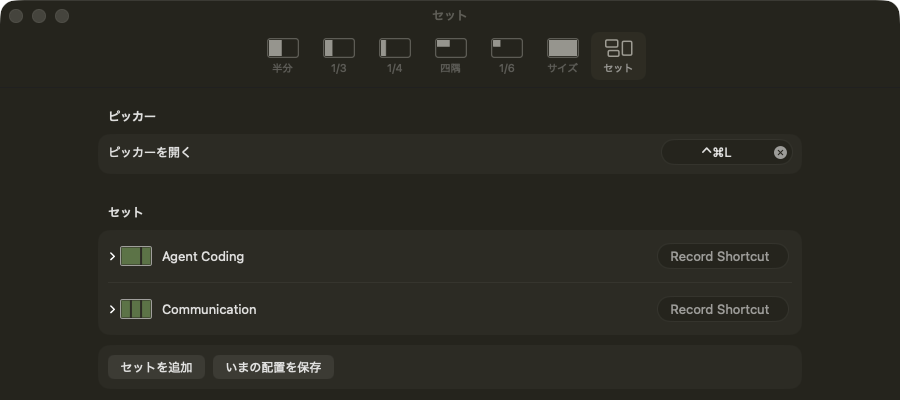
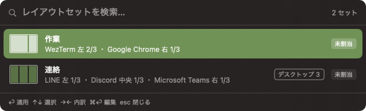

# tatami

Snap macOS windows into place with keyboard shortcuts.

キーボードショートカットで最前面ウィンドウを決まった区画へ移動・リサイズするメニューバー常駐アプリです。

## 動作環境

- macOS 26 以降
- アクセシビリティ権限（初回起動時に案内が出ます）

## ショートカット

Raycast の Window Management と同じ区画が使えます。コマンドは設定画面（メニューバー → 設定…）でカテゴリごとに一覧になっていて、使うものだけをオンにします。オフのコマンドはキーを登録しないので、他のアプリの同じキーを奪いません。

初期状態では次の 8 つだけがオンです。修飾キーはすべて ⌃⌥（Control + Option）で、キーは設定画面から変更できます。

| キー | 動作 |
|---|---|
| ⌃⌥b | 左半分 → 左 1/3 → 左 2/3 →（ループ） |
| ⌃⌥f | 右半分 → 右 1/3 → 右 2/3 →（ループ） |
| ⌃⌥p | 上半分 |
| ⌃⌥n | 下半分 |
| ⌃⌥m | 最大化 |
| ⌃⌥z | 左 1/3 |
| ⌃⌥x | 中央 1/3 |
| ⌃⌥c | 右 1/3 |

次のコマンドは初期状態ではオフで、キーも割り当てられていません。設定画面でオンにしてキーを記録すると使えます。

| カテゴリ | コマンド |
|---|---|
| 1/3 | 左 2/3、右 2/3 |
| 1/4 | 左 1/4、左から 2 番目の 1/4、左から 3 番目の 1/4、右 1/4 |
| 四隅 | 左上、右上、左下、右下 |
| 1/6 | 左上 1/6、中央上 1/6、右上 1/6、左下 1/6、中央下 1/6、右下 1/6 |
| サイズ | 高さを最大化（幅はそのまま）、幅を最大化（高さはそのまま）、中央に配置（大きさはそのまま） |

いったんオフにしてもキーの割り当ては残るので、再びオンにすれば同じキーで動きます。

## レイアウトセット

複数のウィンドウを、アプリ・区画・デスクトップの組み合わせとしてまとめて配置します。「連絡」「作業」のようにセットを作っておけば、1 回の操作で一式が並びます。

設定画面の「セット」タブで管理します。

- 「セットを追加」: 行を手で組みます。1 行は、アプリ、タイトルの絞り込み（任意）、区画（27 種類）、デスクトップ（1〜10 または「変えない」）です。
- 「いまの配置を保存」: 見えているウィンドウを行として取り込みます。区画は最も近いものに丸められ、自由なサイズのウィンドウは「何もしない」になります。タイトルの絞り込みは空のままです。保存時にどのデスクトップの配置かを聞かれます（「指定しない」も選べます）。
- セットごとにショートカットキーを割り当てられます。「ピッカーを開く」はグローバルなキーで、初期状態では割り当てがありません。メニューバーにも「ピッカー…」と各セットが並びます。

<p align="center">
  
</p>

ピッカーでは ⏎ で適用、↑↓ で選択、→← で内訳の表示、⌘⏎ で編集、esc で閉じます。クリックでも適用できます。適用後は結果が HUD に出ます（「連絡: 3 件を配置」、「連絡: 3 件中 2 件を配置 ・ Microsoft Teams は起動していません」など）。

<p align="center">
  
</p>

ピッカーには 27 種類の区画も並び、⏎ で「ピッカーを開く直前に最前面だったウィンドウ」に適用します。設定でオフにしているコマンドやキー未割り当ての区画も使えます。検索は日本語名のほか、英語（`left third`）、略号（`l3`、`tl`、`max`）、ローマ字（`migi`）、記号（`<` `>` `^` `v`、四隅は `<^` など）、分数（`1/3`）で前方一致します。ピッカーが開いている間は入力ソースが ABC に切り替わり、閉じると戻ります。⌘D か行の ★ でお気に入りにすると、区画の先頭に出ます。

### デスクトップの移動

tatami は、ウィンドウのタイトルバーを合成マウスイベントで掴んだまま、Mission Control の「デスクトップ N へ切り替え」のショートカットを押して、ウィンドウを別のデスクトップへ運びます。非公開 API は使いません。次の設定が必要です。

- システム設定 → キーボード → キーボードショートカット → Mission Control で「デスクトップ N へ切り替え」をオンにする。
- システム設定 → デスクトップと Dock → Mission Control の「最新の使用状況に基づいて操作スペースを自動的に並べ替える」をオフにする。セットの設定画面の「オフにする」ボタンでも切り替えられます（Dock が再起動します）。オンの間はデスクトップの移動を飛ばし、区画だけを適用します。
- システム設定 → デスクトップと Dock → Mission Control の「アプリケーションの切り替えで、アプリケーションのウインドウが開いているスペースに切り替える」をオンにする。別のデスクトップにあるウィンドウを回収する前提です。オフのときはセットの設定画面に警告が出ます。

### 制約

- デスクトップの番号は Mission Control の並び全体の通し番号です。複数ディスプレイには対応しておらず、別のディスプレイのデスクトップを指すことがあります。
- 存在しない番号を指定すると、通常は「切り替わりませんでした」になります。ただし対象のウィンドウがいまのデスクトップにある場合は、成功と表示されることがあります（番号が存在するかを公開 API で確かめられないため）。
- フルスクリーンのウィンドウは対象外です。
- タイトルバーのないアプリ（WezTerm の `window_decorations = "RESIZE"` など）は移動できません。
- セキュア入力中（パスワード欄、Secure Keyboard Entry）は移動できません。
- 同じアプリに同じ枠のウィンドウが 2 枚あると、「タイトルバーを掴めませんでした」になることがあります。
- 手で入力した bundle identifier が通常のアプリでない場合は「起動していません」として扱われます（HUD にもそう出ます）。

### うまく動かないとき

デバッグメニューを出して、ログを見ます。

```sh
defaults write dev.hidekingerz.tatami debugMenu -bool YES
log stream --predicate 'subsystem == "dev.hidekingerz.tatami" AND category == "Debug"' --level debug
```

## ビルド

Xcode 26 以降が必要です。

```sh
xcodebuild -project Tatami.xcodeproj -scheme Tatami -destination 'platform=macOS' -derivedDataPath build/DerivedData build
xcodebuild -project Tatami.xcodeproj -scheme Tatami -destination 'platform=macOS' -derivedDataPath build/DerivedData test
```

Xcode で `Tatami.xcodeproj` を開いて Run しても動きます。

ビルドしたアプリはリポジトリ内の `build/DerivedData/Build/Products/Debug/Tatami.app` にできます（`build/` は git 管理外です）。
`/Applications` にコピーして起動すると、アクセシビリティ権限の登録先のパスが固定されます。

### 「xcodebuild requires Xcode」と言われたら

`xcode-select` の向き先が Command Line Tools になっています。Xcode を入れる前に Command Line Tools を入れていると（Homebrew が自動で入れるケースを含む）この状態になります。Xcode 本体へ切り替えてください。

```sh
xcode-select -p   # /Library/Developer/CommandLineTools なら要切り替え
sudo xcode-select --switch /Applications/Xcode.app/Contents/Developer
```

切り替えても Command Line Tools は残り、Homebrew などはそのまま動きます。

## 署名とアクセシビリティ権限

macOS はアクセシビリティ権限をアプリの署名に紐づけて保存します。署名が証明書ベースなら再ビルドしても権限は引き継がれますが、アドホック署名（`CODE_SIGN_IDENTITY = "-"`）ではビルドごとに署名が変わり、システム設定では許可済みのままなのに動かない状態になります。

このプロジェクトは `Apple Development` 証明書で署名する設定（`CODE_SIGN_STYLE = Automatic`、`DEVELOPMENT_TEAM` 指定）になっています。自分の環境でビルドする場合は、Xcode > Settings > Accounts に Apple ID を追加し（無料の Personal Team で可）、`Tatami.xcodeproj` の `DEVELOPMENT_TEAM` を自分のチーム ID に書き換えてください。証明書を用意しない場合は `CODE_SIGN_IDENTITY = "-"` に戻してアドホック署名でビルドできます。

### 権限が効かなくなったら

ショートカットを押してもビープ音が鳴るだけ、あるいはメニューに「アクセシビリティ権限が必要です…」が出続ける場合は、古い署名に紐づいた権限エントリが残っています。次のコマンドでエントリを消し、tatami を起動し直して許可し直してください。

```sh
tccutil reset Accessibility dev.hidekingerz.tatami
```

システム設定 > プライバシーとセキュリティ > アクセシビリティ で tatami を削除（−）して追加し直しても同じです。

### 署名時に「unable to build chain to self-signed root」が出たら

Apple の中間証明書（WWDR G3）がキーチェーンにありません。[Apple PKI](https://www.apple.com/certificateauthority/) から `AppleWWDRCAG3.cer` を取得してログインキーチェーンに追加してください。

```sh
curl -O https://www.apple.com/certificateauthority/AppleWWDRCAG3.cer
security import AppleWWDRCAG3.cer -k ~/Library/Keychains/login.keychain-db
security find-identity -v -p codesigning   # 1 valid identities found になれば OK
```

### 署名時に「errSecInternalComponent」が出たら

SSH でログインしたシェルからビルドしている場合に出ます。SSH セッションではログインキーチェーンがロックされたままで、`codesign` が秘密鍵の使用許可を得られません（証明書や設定の問題ではなく、Mac の前で開いたターミナルや Xcode からは同じコマンドが通ります）。ビルド前に同じシェルでキーチェーンをアンロックしてください。

```sh
security unlock-keychain ~/Library/Keychains/login.keychain-db
```

SSH で入り直すたびに必要です。毎回入力したくない場合は、署名鍵を `codesign` から確認なしで使えるようにしておけます。

```sh
security set-key-partition-list -S apple-tool:,apple:,codesign: -s -k "<ログインパスワード>" ~/Library/Keychains/login.keychain-db
```

## ライセンス

MIT
